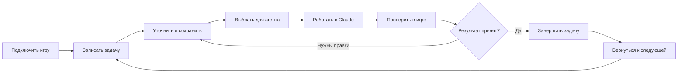

# Аудит интерфейса Опоры 0.23.0

Дата: 7 ноября 2026. Проверен исходный коммит `f26252b52209d66bb82c792ac60296666ed6afdc`.

**Главный вывод:** функции уже связаны на уровне данных, но пользователю всё ещё приходится связывать их в голове. Наиболее важны однозначный выбор задачи для агента, сохранность постановок и единый переход от ответа агента к проверке результата. Последнее упрощение снизило шум рабочего стола, но само по себе не решило эти разрывы.

**13 проблем: 5 P1 и 8 P2.** Приоритеты относительные для этого продукта; сроки и потери времени не оценивались.

[Интерактивная карта и фильтры](index.html) · [Данные аудита](findings.json) · [Наблюдения прогона](evidence.json) · [Сценарий воспроизведения](audit.cjs)

## Как проверялось

- Реальный Electron в Linux, два синтетических проекта Godot; экраны 1360×920 и 980×720. Открытие проекта, форма задачи, удаление, доска из 51 задачи, история чата, выбор текущей задачи, отчёты, брендбук, карта, контекст, замечания и компактный чат.
- Две отправки через официальный SDK с локальным тестовым CLI. Реальная модель не вызывалась. Проверены task_id и ID разговора до и после переключения задачи.
- Зафиксированы 14 кадров интерфейса, состояние DOM, выбранные значения и исходные обработчики. Ошибок JavaScript renderer в итоговом прогоне: 0. Ноль ошибок исполнения не означает отсутствие проблем удобства.
- Это экспертный аудит с воспроизводимыми сценариями, а не исследование реальных пользователей. Риски восприятия и предложенные решения требуют последующей проверки на человеке. Не измерялись скорость работы пользователя, стоимость модели и соответствие WCAG.
- Локальная Windows-авторизация Claude и качество ответов модели не проверялись. Обновление и восстановление Windows опираются на уже опубликованный [отчёт проверки 0.23.0](../windows-update-validation-0.23.0.json); новая ручная Windows-проверка в этом аудите не проводилась.
- Программа и пользовательские проекты не изменялись. Данные аудита — вымышленные, без аккаунтов и API-ключей.

## Карта пути пользователя

| Этап | Как работает сейчас | Где теряется ясность |
| --- | --- | --- |
| Подключить игру | Первый запуск → демопроект → выбрать папку → автоматический переход в брендбук. | Вместо первого действия — поля стиля и оценка незаполненных правил. |
| Записать задачу | Задачи → новая задача → название + обязательные критерии → сохранить в очередь. | Детализацию нужно сделать заранее; большая очередь не имеет поиска. |
| Уточнить и сохранить | Форма задачи → текст и пути → сохранить / отменить / удалить. | Черновик исчезает после Escape; удаление сразу убирает задачу. |
| Подготовить запуск | Статус на доске + выбор текущей задачи + карточка + подключение агента. | «В работе» и выбор для агента различаются; «настроено» не сообщает о реальном обращении. |
| Работать с Claude | Выполнить задачу / открыть историю → отправить сообщение → следить за действиями. | Старый разговор может получить новую задачу; предпросмотр показывает только часть пакета. |
| Проверить результат | Ответ → отчёт в подключениях → Godot → снимок и замечания → принятие результата → завершение задачи. | Готовность спрятана в нескольких местах; форма замечания может неверно объяснить ошибку. |
| Вернуться к работе | Рабочий стол → текущая задача → история / карточка / отчёты; команды через Ctrl+K. | Нет заметного итога последней работы; названия поиска расходятся с меню, часть подписей мелкая. |

## Приоритетные проблемы

| ID | Приоритет | Проблема | Подтверждение |
| --- | --- | --- | --- |
| [UX-01](#ux-01) | P1 | Задача беседы меняется незаметно | Воспроизведено |
| [UX-02](#ux-02) | P1 | «В работе» не означает «выбрана для агента» | Воспроизведено |
| [UX-03](#ux-03) | P1 | Черновик задачи теряется при закрытии | Воспроизведено |
| [UX-04](#ux-04) | P1 | Удаление задачи невозможно отменить в интерфейсе | Воспроизведено |
| [UX-05](#ux-05) | P1 | Результат работы не превращается в понятный следующий шаг | Воспроизведено + экспертная оценка |
| [UX-06](#ux-06) | P2 | Первое подключение игры ведёт в сложный брендбук | Воспроизведено + экспертная оценка |
| [UX-07](#ux-07) | P2 | Быстро записать идею нельзя без критериев | Воспроизведено + экспертная оценка |
| [UX-08](#ux-08) | P2 | Доска не помогает найти задачу в большой очереди | Воспроизведено + экспертная оценка |
| [UX-09](#ux-09) | P2 | Названия разделов не совпадают с поиском команд | Воспроизведено |
| [UX-10](#ux-10) | P2 | Форма замечания неверно объясняет обязательное поле | Воспроизведено |
| [UX-11](#ux-11) | P2 | Мелкие подписи и вложенная прокрутка затрудняют чтение | Измерено + экспертная оценка |
| [UX-12](#ux-12) | P2 | Настройка подключения не показывает факт успешной работы | По коду + экспертная оценка |
| [UX-13](#ux-13) | P2 | Предпросмотр контекста неполон и труден для проверки человеком | Воспроизведено + по коду |

### UX-01 · P1 · Задача беседы меняется незаметно

**Наблюдение.** В одной беседе отправлено сообщение по задаче A «Улучшить меню». После выбора B «Настроить баланс» открыта та же беседа. До отправки её task_id и подпись контекста всё ещё относятся к A; подпись скрыта в настройках. Следующее обычное «Продолжай» отправляется уже с task_id B. ID беседы остаётся прежним.

**Последствие.** Пользователь продолжает старую мысль, а агент получает новую задачу. Это способно привести к правкам не того участка игры, хотя технически пакет контекста обновляется корректно.

**Изменение.** Явно связать разговор с задачей и постоянно показывать эту связь над вводом. Смену задачи для беседы выполнять через заметный переключатель. Для общего обсуждения оставить режим «Без задачи». Не добавлять всплывающие подтверждения к каждому сообщению.

**Критерий проверки.** После выбора другой задачи и открытия старой беседы ещё ДО отправки видно, к какой задаче относится следующее сообщение. Фактический task_id запроса совпадает с показанным; нужно проверить обычную отправку, запуск из карточки и возобновление истории.

[Кадр](04-resumed-chat.png) · [Исходник](https://github.com/Isedis/basket/blob/f26252b52209d66bb82c792ac60296666ed6afdc/desktop/main.cjs#L216)

### UX-02 · P1 · «В работе» не означает «выбрана для агента»

**Наблюдение.** Перевод B в статус «В работе» через список на доске не меняет текущую задачу A в боковой панели. Кнопка «В работу →» выполняет другое действие: назначает задачу текущей и меняет её статус. Два сходных названия управляют разными состояниями.

**Последствие.** Человек считает, что уже выбрал B, и запускает текущую A. Несколько задач «В работе» сами по себе допустимы; проблема в неясном различии статуса и выбора.

**Изменение.** Разделить названия: статус задачи и кнопка «Сделать текущей». Показывать единственную текущую задачу для запуска в одном и том же месте; кнопка запуска должна содержать её название или находиться внутри её карточки.

**Критерий проверки.** При смене статуса пользователь видит, изменился ли выбор для агента. Из карточки B всегда запускается B; общий запуск показывает текущую задачу. Отсутствие текущей задачи объяснено явно.

[Кадр](03-task-board.png) · [Исходник](https://github.com/Isedis/basket/blob/f26252b52209d66bb82c792ac60296666ed6afdc/ui/app.js#L394)

### UX-03 · P1 · Черновик задачи теряется при закрытии

**Наблюдение.** Введены название и критерии новой задачи. После Escape и повторного открытия формы название пустое. У формы нет восстановления черновика. Проектные поля и черновики чата сохраняются, поэтому ожидания от сохранения различаются.

**Последствие.** Можно потерять длинную постановку задачи, составленную вручную. Пользователь вынужден помнить, где автосохранение действует, а где нет.

**Изменение.** Автоматически сохранять черновик формы отдельно от опубликованных задач, с привязкой к проекту. При повторном открытии восстанавливать текст; отдельное действие «Очистить черновик».

**Критерий проверки.** Название, критерии и файлы восстанавливаются после Escape, отмены и перезапуска. Черновики разных игр не смешиваются. Сохранённая задача не создаётся повторно.

[Кадр](03-task-board.png) · [Исходник](https://github.com/Isedis/basket/blob/f26252b52209d66bb82c792ac60296666ed6afdc/ui/app.js#L349)

### UX-04 · P1 · Удаление задачи невозможно отменить в интерфейсе

**Наблюдение.** В форме редактирования нажатие «Удалить» сразу удаляет карточку. Восстановления или кнопки отмены нет. Это проверено на отдельной тестовой задаче; пользовательские данные не затрагивались.

**Последствие.** Одна ошибочная команда лишает пользователя задачи и её связей. Необходимость искать резервные файлы противоречит назначению программы.

**Изменение.** Добавить корзину или мягкое удаление с «Отменить». Не заменять это постоянными диалогами подтверждения: пользователь уже просил меньше ручных согласований.

**Критерий проверки.** Удалённую задачу можно восстановить вместе с критериями и связями после навигации и перезапуска. Связанные отчёты и замечания не удаляются каскадно.

[Кадр](03-task-board.png) · [Исходник](https://github.com/Isedis/basket/blob/f26252b52209d66bb82c792ac60296666ed6afdc/ui/app.js#L495)

### UX-05 · P1 · Результат работы не превращается в понятный следующий шаг

**Наблюдение.** Добавлен отчёт ready_for_review по текущей задаче. Главный экран по-прежнему показывает «В работе» и «Выполнить в Claude», без сигнала о новом результате. Карточка задачи правильно показывает report_review. Общие отчёты расположены под настройками в «Подключениях»; ссылка из чата ведёт туда. Визуальные замечания и завершение задачи подтверждаются отдельно.

**Последствие.** После ответа агента непонятно, что уже сделано и что проверять. Человек может повторно запустить задачу или забыть принять результат. Возвращение к проекту требует просмотра нескольких мест.

**Изменение.** Добавить на рабочий стол состояние «Есть результат для просмотра» и действие «Проверить результат». Открывать отчёт конкретной задачи, а не общий экран подключений. В одной проверке показать изменения, доступные проверки, снимки и оставшиеся замечания. Сохранить отдельное осознанное завершение задачи пользователем.

**Критерий проверки.** Новый отчёт заметен на рабочем столе; из него доступен нужный результат за один переход. Непроверенные части явно указаны. Принятие снимка не выдаётся за завершение всей задачи, автоматического принятия нет.

[Кадр](05-result-not-on-home.png) · [Исходник](https://github.com/Isedis/basket/blob/f26252b52209d66bb82c792ac60296666ed6afdc/ui/app.js#L169)

### UX-06 · P2 · Первое подключение игры ведёт в сложный брендбук

**Наблюдение.** Первый запуск показывает наполненный демопроект. После подключения пустого Godot-проекта автоматический анализ переключает пользователя в «Брендбук». В тесте он сразу видит разбор 0/9 и технические поля, а кнопки создания задачи на этом экране нет.

**Последствие.** Программа начинает с настроек стиля вместо первого полезного результата. Есть риск решить, что сначала обязательно заполнить весь брендбук. Это гипотеза о восприятии, а не результат наблюдения за реальными пользователями.

**Изменение.** После выбора папки оставить понятный первый шаг: «Опишите, что хотите сделать» / «Открыть Claude». Черновик брендбука готовить в фоне и показывать как необязательное предложение. Демо отделить от личного проекта более явным стартовым экраном.

**Критерий проверки.** Новый пользователь может создать первую задачу и открыть Claude, не заполняя брендбук. Видны выбранная папка и следующий шаг; демоданные не воспринимаются как содержимое его игры.

[Кадр](02-first-project.png) · [Исходник](https://github.com/Isedis/basket/blob/f26252b52209d66bb82c792ac60296666ed6afdc/ui/app.js#L352)

### UX-07 · P2 · Быстро записать идею нельзя без критериев

**Наблюдение.** Форма новой задачи требует и название, и критерии. Также сразу предлагает ручной ввод путей файлов. При этом сохранённые агентом задачи без критериев уже поддерживаются, а проверка готовности умеет ненавязчиво об этом сообщать.

**Последствие.** Для короткой идеи пользователь должен заранее выполнить работу по детализации. Поле путей выглядит как техническая обязанность для человека, который не программирует.

**Изменение.** Дать быстрое создание по одному названию. Детализацию и критерии предлагать через агента; файлы раскрывать как необязательную настройку с выбором на карте. До запуска сохранять полезные рекомендации проверки готовности.

**Критерий проверки.** Короткая идея сохраняется без заполнения технических полей. Агент может предложить критерии, а пустые критерии видны как рекомендация, не как запрет создать запись.

[Кадр](03-task-board.png) · [Исходник](https://github.com/Isedis/basket/blob/f26252b52209d66bb82c792ac60296666ed6afdc/ui/app.js#L405)

### UX-08 · P2 · Доска не помогает найти задачу в большой очереди

**Наблюдение.** В тестовом проекте 51 задача: 26 в очереди, 1 в работе, 24 завершённые. Доска выводит все карточки. Поиска задач и фильтров нет; завершённые занимают равноправную колонку. Это проверка представления, а не измерение производительности.

**Последствие.** Со временем нужно прокручивать историю и читать карточки, чтобы найти конкретную задачу. Визуальная нагрузка растёт вместе с накоплением работы.

**Изменение.** Добавить поиск по названию, фильтры «Текущая», «Нужен просмотр», «Из замечаний». Завершённые сворачивать в архив с доступной историей. Не терять сохранённые связи.

**Критерий проверки.** В наборе из 100 задач можно найти запись по части названия, показать ожидающие просмотра и открыть завершённую задачу. Фильтры не меняют данные.

[Кадр](03-task-board.png) · [Исходник](https://github.com/Isedis/basket/blob/f26252b52209d66bb82c792ac60296666ed6afdc/ui/app.js#L228)

### UX-09 · P2 · Названия разделов не совпадают с поиском команд

**Наблюдение.** Боковая панель называет разделы «Подключения» и «Передача контекста», а палитра команд хранит «Агенты» и «Контекст». Поиск по двум точным названиям из навигации возвращает ноль команд. Справка также использует старое слово «Агенты».

**Последствие.** Пользователь ищет видимую функцию по её названию и получает «Действие не найдено». Одинаковые функции кажутся разными разделами.

**Изменение.** Использовать общий справочник названий и действий для навигации, палитры, справки и кнопок. Старые названия оставить синонимами.

**Критерий проверки.** Все видимые названия разделов находятся через Ctrl+K. Справка и навигация называют один раздел одинаково; английские и старые синонимы продолжают работать.

[Кадр](12-compact.png) · [Исходник](https://github.com/Isedis/basket/blob/f26252b52209d66bb82c792ac60296666ed6afdc/ui/app.js#L645)

### UX-10 · P2 · Форма замечания неверно объясняет обязательное поле

**Наблюдение.** Выбрана область действия «Указанная сцена / файл», но поле сцены всё ещё подписано «необязательно» и не имеет required. Сохранение с пустым полем завершается сообщением: «Error invoking remote method … Укажите комментарий, область и область применения решения». Текст замечания был заполнен.

**Последствие.** Интерфейс обещает, что поле можно пропустить, а ошибка не указывает, какое именно поле исправить. Техническая оболочка ошибки отвлекает от действия.

**Изменение.** Динамически менять обязательность сцены, показывать ошибку рядом с полем и переводить ошибки IPC в понятное сообщение. Черновик и выделенную область сохранять при ошибке.

**Критерий проверки.** Для области «сцена» явно требуется путь, фокус попадает в нужное поле. При неверном вводе сохраняется текст и область; служебный префикс remote method не показывается пользователю.

[Кадр](11-feedback-validation.png) · [Исходник](https://github.com/Isedis/basket/blob/f26252b52209d66bb82c792ac60296666ed6afdc/src/visual-feedback.cjs#L93)

### UX-11 · P2 · Мелкие подписи и вложенная прокрутка затрудняют чтение

**Наблюдение.** При 980×720 текст навигации имеет 10 px. Несколько кнопок очереди имеют высоту 22–23 px. На экранах брендбука и чата видны несколько независимых областей прокрутки. При этом поле ввода в проверенном компактном чате остаётся в окне; горизонтального переполнения рабочего стола нет.

**Последствие.** Информационная плотность всё ещё высока для длительной работы. При масштабировании Windows и слабом зрении чтение может быть затруднено; конкретное влияние на людей пока не измерено.

**Изменение.** Увеличить базовые подписи и области нажатия; добавить общий масштаб интерфейса, а не только шрифт Claude. Оставить отдельную прокрутку там, где она защищает ввод, но сократить одновременные скроллеры справочной информации.

**Критерий проверки.** Проверить интерфейс при 100/125/150% на Windows, с клавиатурой и длинными названиями. Важные действия остаются видимыми. Оценка соответствия WCAG требует отдельной проверки, в этом аудите она не заявляется.

[Кадр](13-compact-chat.png) · [Исходник](https://github.com/Isedis/basket/blob/f26252b52209d66bb82c792ac60296666ed6afdc/ui/style.css#L235)

### UX-12 · P2 · Настройка подключения не показывает факт успешной работы

**Наблюдение.** Карточка показывает «НАСТРОЕНО», когда сохранена конфигурация MCP. Что это не подтверждение соединения, объяснено внутри «Настройки MCP». В сценарии открытия встроенного чата настройка создаётся автоматически. Отдельного видимого факта успешного чтения этого проекта агентом на карточке нет.

**Последствие.** Пользователю сложно понять, видит ли агент именно его проект. Само слово «настроено» технически корректно; утверждения о сломанном соединении здесь нет.

**Изменение.** Разделить «Настройка сохранена» и наблюдаемый факт «Последний успешный запрос: …, проект …». Показывать имя проекта и доступное действие диагностики. Не имитировать постоянное соединение для локального stdio MCP.

**Критерий проверки.** После реального обращения агента виден подтверждённый факт и время, до обращения показано «Ещё не проверено». Сохранённая конфигурация не объявляется живым соединением.

[Кадр](07-connections-and-reports.png) · [Исходник](https://github.com/Isedis/basket/blob/f26252b52209d66bb82c792ac60296666ed6afdc/ui/app.js#L238)

### UX-13 · P2 · Предпросмотр контекста неполон и труден для проверки человеком

**Наблюдение.** «Посмотреть контекст» выводит JSON только с project, task, passport, brand, feedback. Реальный пакет также содержит task_plan, readiness, references, map, warnings и инструкции. Проверено по ключам обоих объектов. Текстовый раздел «Передача контекста» тоже показывает техническую памятку.

**Последствие.** Пользователь не может по предпросмотру проверить все сведения, доступные агенту. После появления проверки готовности и этапов такой экран уже не отражает состав реального пакета. Агент эти данные получает; проблема в отображении.

**Изменение.** Сделать человекочитаемую сводку следующего пакета: задача, критерии, правила, файлы, решения, этапы, замечания готовности. Полный JSON и режим передачи full/delta оставить под «Технические данные».

**Критерий проверки.** Сводка перечисляет все смысловые части действительного пакета, включая этапы и readiness. Видно, относится ли экран к прошлой отправке или следующей. Полные технические данные доступны без расхождения с отправкой.

[Кадр](14-context-preview.png) · [Исходник](https://github.com/Isedis/basket/blob/f26252b52209d66bb82c792ac60296666ed6afdc/ui/claude-chat.js#L110)

## Что уже помогает работе

- Текущая задача и очередь заметны на рабочем столе; описание игры и постоянные правила можно свернуть.
- Единая карточка действительно связывает критерии, файлы, замечания, правила, этапы и отчёты. Проверка готовности видит отчёт для просмотра и не блокирует обычный запуск.
- В чате есть поток ответа, деятельность агента, история, вопросы и токены. В проверенном компактном режиме поле ввода остаётся доступным.
- Брендбук после редактирования снова становится черновиком; предложения агента не выдаются за пользовательское утверждение. Отчёты и снимки не считаются автоматически принятыми.
- Карта сохраняет выбор в пределах проекта, поддерживает поиск файлов и раскрывает связи выбранного узла. Это полезный вспомогательный инструмент, но она не заменяет экран состояния работы.
- Данные проекта сохраняются отдельно от программы. Текущий Windows-канал имеет проверенный запуск и откат. В этом аудите не найдено оснований связывать описанные UX-проблемы с потерей файлов игры.

## Дополнительные маршруты

**Правила стиля:** брендбук → редактирование / черновик агента → просмотр правил и образцов → утверждение. Это отдельное решение о стиле, а не условие начала каждой задачи. На первом запуске интерфейс должен объяснять эту необязательность.

**Визуальные замечания:** добавить снимок → выбрать область → комментарий и область действия → сохранить → связать с задачей → агент прикладывает результат → сравнить → принять или вернуть → отдельно завершить задачу. Связи в данных есть; пользовательский маршрут нуждается в объединённом просмотре.

**Карта:** система → файл → зависимости → закрепить в карточке. Удобна для уточнения области работы, но человеку без знания кода следует показывать её как необязательный способ указать место задачи.

**Внешний агент:** подключение MCP → реальный запрос к этому проекту → работа через cmd → отчёт. Ручное копирование и обновление файлов контекста — запасной путь; следует явно обозначить, когда он нужен.

**Обновление и возврат:** Обновления в боковой панели → проверка и установка → перезапуск → текущий проект. Существующий Windows-прогон подтверждает этот путь; пережитые ранее проблемы требуют понятного результата обновления и сохранения журналов, но не являются доказательством нового бага версии 0.23.0.

## Рекомендуемый порядок улучшений

1. **Сначала защитить намерение и труд пользователя:** UX-01, UX-02, UX-03, UX-04. Однозначная задача беседы, ясный выбор текущей задачи, черновики и отмена удаления.
2. **Замкнуть рабочий цикл:** UX-05. Рабочий стол сообщает о результате; одна кнопка открывает проверку именно этой задачи. Завершение остаётся решением пользователя.
3. **Облегчить вход и рост проекта:** UX-06, UX-07, UX-08. Первая задача вместо обязательного погружения в брендбук, быстрое создание, поиск и архив.
4. **Согласовать объяснения и читаемость:** UX-09–UX-13. Общие названия, адресные ошибки, масштаб, наблюдаемое состояние подключения и полный понятный предпросмотр.

Новый основной маршрут должен читаться как **задача → агент → результат → проверка → следующий шаг**. Карта, брендбук и подключения обслуживают этот маршрут. Добавлять ещё один равноправный раздел для каждой функции не требуется.

## Проверка улучшенного маршрута с пользователем

После исправлений дать человеку без подсказок пять заданий: подключить игру и записать идею; выбрать задачу B при текущей A; продолжить старую беседу и назвать задачу следующего сообщения; восстановить закрытый черновик и удалённую задачу; найти готовый результат и вернуть его на доработку.

Фиксировать ошибочные действия, просьбы о помощи и переходы. Успех — человек правильно понимает выбранную задачу и следующий шаг, не теряет ввод и находит результат. Сравнение времени имеет смысл только после такого наблюдения, а не по субъективной оценке автора аудита.

## Воспроизведение

Из корня репозитория с установленными зависимостями: `node docs/interface-audit-0.23/audit.cjs`. Сценарий рассчитан на Linux Electron и перезаписывает только доказательства в этой папке; рабочие проекты пользователя не открывает. Для запуска используется локальный CLI без модельных запросов. Папка аудита содержит снимки синтетических данных.
