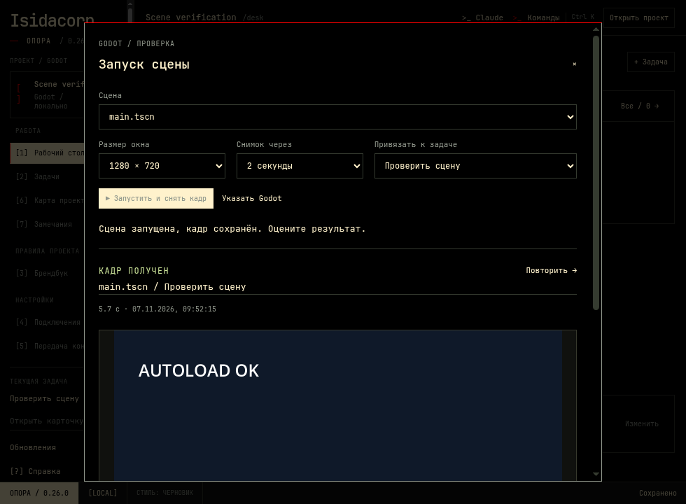

# Запуск сцен Godot · Опора 0.26.0

На рабочем столе нажмите **«Запустить сцену»**. Та же кнопка есть в карте проекта и в проверке результата задачи. В карте запускается выбранная сцена, иначе предлагается главная сцена проекта. Если Godot отсутствует в PATH, один раз выберите исполняемый файл через **«Указать Godot»**. Для внешнего MCP после смены Godot обновите подключение в «Подключениях» и начните новую сессию агента.

Выберите сцену, размер окна, задержку снимка и задачу. Опора импортирует ресурсы, открывает настоящее игровое окно Godot 4, сохраняет изображение его viewport и закрывает игру. Доступны остановка, журнал и последние запуски. Рабочий стол и другие приложения не снимаются. Автозагрузки проекта работают. Игра может записывать свои обычные сохранения.

Агент использует `opora_run_scene` с `project_id`, необязательным `scene` (путь внутри проекта либо `res://...`) и `task_id`. По умолчанию вызов ожидает результат; `wait=false` возвращает ID фонового запуска. Отсутствующий task_id использует текущую задачу, явный null означает работу без задачи. Для встроенного чата агенту передаётся его закреплённая задача, независимо от навигации на доске.

`opora_scene_result` читает запуск по `run_id`, последние запуски с фильтром `task_id`, останавливает его (`action=stop`) или возвращает реальный PNG (`action=image`). Длинный журнал читается отдельно (`action=log`, `offset`): по 8000 символов на страницу, вместо передачи полного журнала при каждом запросе. Задачу, правила и брендбук эти инструменты не принимают и не завершают. Изображение проверяется по SHA256 перед выдачей. Последние три результата этой задачи включаются в компактный рабочий контекст; журнал и изображения агент читает по необходимости. В отчёт ответа включается завершённая проверка той же задачи за время ответа, если её версия кода ещё актуальна.

Ограничения: импорт — до 45 секунд, игровое окно — до 30 секунд; ожидание кадра 0,5–15 секунд, размеры 320–1920 × 240–1080. Одновременно выполняется одна проверка сцены в проекте. Превышение времени, ошибка импорта, диагностическая ошибка даже с кодом выхода 0, раннее закрытие до кадра и отсутствие снимка не считаются успехом. Отмена завершает только принадлежащий проверке процесс Godot; на Windows останавливается его дерево, включая консольный запускатель.

Проверки выполняются отдельным процессом и сохраняются в `.opora/scene-runs/<id>`: запрос, прогресс, итог, PNG. Закрытие Опоры не обрывает проверку; при повторном открытии результат доступен в истории. Если рабочий процесс аварийно завершился, запуск помечается прерванным. Не копируйте и не редактируйте файлы проверки вручную.

`stale_code` и `code_changed_during_run` обозначают изменения индексируемых сцен, скриптов, ресурсов, настроек и UID. Импортированные UID фиксируются перед собственно запуском сцены. Хеши не охватывают пиксели ассетов и аудио. Один кадр подтверждает запуск, но не доказывает качество дизайна, корректность механик и работоспособность всех переходов. Пользователь по-прежнему принимает результат сам. Для проверки текущего состояния после изменений запустите сцену повторно.

Проверки реализации: unit-тесты путей, изоляции проекта/задачи, отмены и конкурирующих запусков; настоящий Godot 4.6.3 (автозагрузки, PNG, ошибка с exit 0, раннее закрытие, зависание, устаревший код, SHA256), MCP, Electron (кнопка, остановка, история, повторное открытие после закрытия приложения), регрессии существующего чата и карточки задачи. Windows-проверка выпуска прошла: [отчёт](windows-update-validation-0.26.0.json), [GitHub Actions](https://github.com/Isedis/basket/actions/runs/42362433738). На сервере без видеокарты реальное окно Godot рендерилось через зарегистрированный программный OpenGL ICD Mesa; настройка используется только в CI и не входит в приложение.
