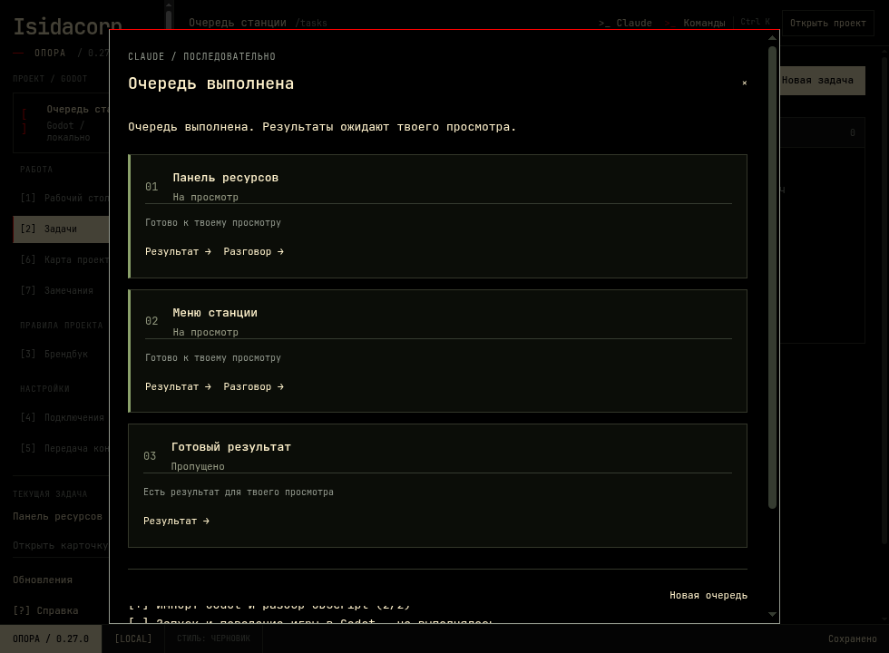

# Очередь задач · Опора 0.27.0

На странице задач, рабочем столе и в панели Claude появилась кнопка «Все задачи в работе». Она открывает список активных задач: можно убрать лишние и изменить порядок. Готовые результаты по умолчанию исключены; задачи без критериев и с приостановленным или устаревшим планом требуют уточнения. До 100 выбранных задач за запуск.

После «Запустить очередь» встроенный Claude выполняет задачи последовательно. У каждой — отдельный разговор, актуальный рабочий пакет с правилами, брендбуком, замечаниями и профилем проекта. Выбранная в навигации задача не переключается. Новые задачи не включаются автоматически; удалённые или перенесённые из «В работе» пропускаются.

## Остановка и восстановление

«Остановить очередь» отменяет текущий запрос и доступные проверки. «Продолжить очередь» использует прежний разговор и сессию незавершённой задачи; готовые результаты не выполняются заново. Перезагрузка интерфейса и штатное обновление сохраняют работающий процесс. После аварийного завершения продолжение запускается вручную. Одновременно в одной игре работает только одна очередь, включая другие копии Опоры.

Вопрос Claude ждёт ответа через обычную карточку вопросов; кнопка «Открыть чат» ведёт к ней. Ошибка, лимит подписки, ошибка проверки, незавершённые этапы либо отсутствие корректного подтверждения завершения останавливают переход к следующей задаче. Автоматических повторных платных запросов нет.

Изменение критериев, названия, файлов или привязанного замечания останавливает задачу. После просмотра новых требований можно явно начать её заново; прежний разговор и отчёты сохраняются. При новой очереди старый контрольный файл архивируется.

## Что считается результатом

Claude возвращает структурированный ответ с точным ID задачи, статусом и итогом. Опора отдельно записывает наблюдаемые изменения, проверки и отчёт. При наличии плана требуется завершить все этапы и интеграцию. В конце выполняется общая проверка Godot по изменениям с начала очереди. Ошибка общей проверки позволяет повторить проверку без повторного выполнения готовых задач.

Без настроенного Godot проверка явно отмечена как невыполненная. Проверки импорта и GDScript не доказывают качество геймплея или графики. Статус «На просмотр» означает готовность результата к рассмотрению. Принятие задачи, перевод в «Готово» и закрытие замечаний остаются за пользователем.

## Технические границы

Очередь использует установленный Claude Code через официальный Agent SDK и существующее подключение MCP. Для старого CLI без поддержки структурированного результата завершение не угадывается по тексту: очередь остановится с объяснением. Автоматического выбора модели нет.

Прогресс и начальный снимок хранятся в `.opora/task-queue.json` рядом с данными игры, история очередей — в `.opora/task-queue-history`. Разговоры остаются в обычной истории Опоры. Настройки запуска и MCP передаются только работающему процессу, в контрольный файл не записываются. Чтение прогресса не вызывает модель. Размер контрольного файла ограничен 16 МиБ; публичный ответ не содержит начальный индекс исходников.

## Проверки

- Модульные сценарии: последовательность, свежий контекст, отсутствие подтверждения, вопросы, остановка и продолжение, изменение требований, пропуск задач, ошибка общей проверки, независимые процессы, восстановление, гонки при захвате блокировки, эквивалентные пути к папке и архив повреждённого файла.
- Реальные Electron, брокер и официальный SDK с локальным CLI-стендом: выбор, исключение готовых результатов, две задачи, перезагрузка окна во время работы, остановка, продолжение той же сессии, вопрос/ответ, отчёты и переход к просмотру. Платные обращения к модели не выполняются.
- Регрессия существующего чата, интерфейса, карточки задач, MCP и запуска Godot.

Все 147 модульных тестов пройдены. [Проверка на Windows](https://github.com/Isedis/basket/actions/runs/42379300226): очередь, чат, карточка задачи, реальные кадры Godot, запуск опубликованного EXE, переход со старой версии, обновление с работающим агентом и аварийный откат — успешно. [Машинный отчёт](windows-update-validation-0.27.0.json).
